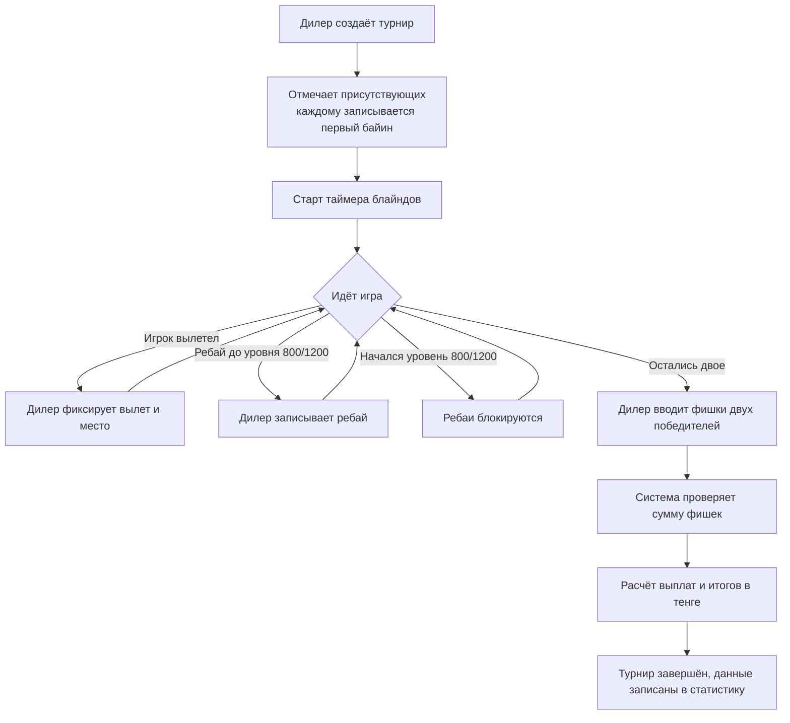
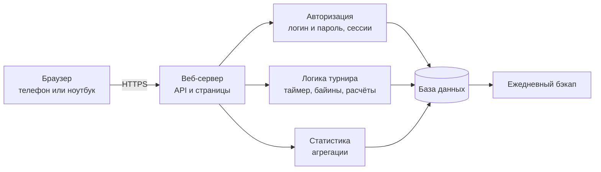
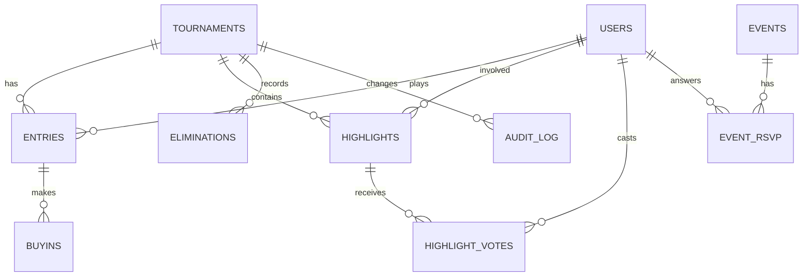

# Poker Club — закрытый сайт локального покерного клуба

Веб-сайт для небольшого закрытого клуба друзей, которые регулярно собираются на покерные турниры. Сайт ведёт турнир, считает фишки и деньги, хранит всю историю игр и показывает статистику по клубу, по каждому турниру и по каждому игроку.

> **Статус:** проектирование. Этот документ описывает, что мы строим и как это будет устроено. Код ещё не написан.

---

## Содержание

1. [Идея проекта](#1-идея-проекта)
2. [Правила клуба](#2-правила-клуба)
3. [Роли и доступ](#3-роли-и-доступ)
4. [Возможности](#4-возможности)
5. [Как проходит турнир](#5-как-проходит-турнир)
6. [Расчёт денег](#6-расчёт-денег)
7. [Архитектура](#7-архитектура)
8. [База данных](#8-база-данных)
9. [Страницы и интерфейс](#9-страницы-и-интерфейс)
10. [Безопасность](#10-безопасность)
11. [Надёжность и бэкапы](#11-надёжность-и-бэкапы)
12. [Структура репозитория](#12-структура-репозитория)
13. [Развёртывание](#13-развёртывание)
14. [Дорожная карта](#14-дорожная-карта)
15. [Чего в проекте не будет](#15-чего-в-проекте-не-будет)
16. [Глоссарий](#16-глоссарий)

---

## 1. Идея проекта

Каждый раз клуб собирается в составе от 5 до 10 человек и играет турнир. Раньше фишки, байины и расчёты вели вручную. Сайт закрывает всю эту рутину:

- дилер фиксирует байины, вылеты и итог прямо со своего телефона или ноутбука;
- система сама считает, кто сколько выиграл или проиграл в тенге;
- результаты автоматически попадают в статистику;
- у каждого игрока есть личный кабинет с историей его игр;
- интересные моменты (редкие комбинации, красивые поты) сохраняются как хайлайты.

Принципы:

- **Просто, но чтобы всё работало.** Минимум зависимостей, одна своя база данных.
- **Закрытый доступ.** Войти можно только по логину и паролю, регистрацию даёт админ.
- **Удобно с телефона и с ноутбука.** Один адаптивный интерфейс, без установки приложений.

---

## 2. Правила клуба

Эти правила заложены в логику сайта и хранятся в настройках, чтобы их можно было изменить без правки кода.

| Параметр | Значение |
|---|---|
| Игроков на турнир | от 5 до 10 |
| Байин | 2 500 тенге |
| Стартовый стек | 5 000 фишек |
| Курс фишки | 2 500 / 5 000 = 0,5 тенге за фишку |
| Ребаи | разрешены первые 2–3 часа, до начала уровня 800/1200 |
| После начала уровня 800/1200 | байины запрещены |
| Победители | двое последних оставшихся игроков |

### Структура блайндов

| Уровень | Малый блайнд | Большой блайнд |
|---|---|---|
| 1 | 20 | 40 |
| 2 | 50 | 100 |
| 3 | 200 | 400 |
| 4 | 400 | 800 |
| 5 | 800 | 1 200 |
| 6 | 1 000 | 2 000 |
| 7 | 2 000 | 4 000 |

Уровень 5 (800/1200) — последний, на котором система ещё считает ребаи допустимыми только до его начала. С начала этого уровня кнопка «байин» блокируется автоматически.

---

## 3. Роли и доступ

Публичной регистрации нет. Аккаунты создаёт только администратор.

| Роль | Что может |
|---|---|
| **Админ** | Создаёт, блокирует и редактирует аккаунты, сбрасывает пароли, меняет настройки клуба (байин, блайнды), исправляет ошибки в завершённых турнирах (с записью в историю правок) |
| **Дилер** | Создаёт и ведёт турнир: отмечает участников, фиксирует байины и вылеты, запускает таймер, вводит финальные фишки победителей, завершает турнир, добавляет хайлайты |
| **Игрок** | Смотрит общую статистику, турниры, свой личный кабинет, голосует за хайлайты, отмечается на ближайшую игру |

Один человек может иметь несколько ролей (например, админ и игрок).

---

## 4. Возможности

### Ядро

- Вход по логину и паролю.
- Управление пользователями (только админ).
- Ведение турнира: участники, байины, ребаи, вылеты, места.
- Автоматическая блокировка ребаев с начала уровня 800/1200.
- Ввод фишек двух победителей и автоматический расчёт выплат в тенге.
- Запись результатов в статистику.
- Таблица побед по турнирам за всё время (в каждом турнире два победителя).
- Личный кабинет игрока: все игры, статистика, итог в тенге и в байинах.
- Аккаунт дилера.

### Статистика

- Общая статистика клуба по всем турнирам.
- Статистика одного турнира: участники, байины, места, банк, выплаты, хайлайты.
- Статистика одного игрока: победы, прибыль, ROI, лучшие и худшие турниры, график прибыли по времени.
- Рейтинг игроков по очкам за места.
- Серии: сколько турниров подряд в плюсе, в призах.
- Средняя позиция вылета и частота выхода в финальную пятёрку.
- Сравнение двух игроков: личные встречи, кто кого чаще выбивал.
- Рейтинги по месяцам и сезонам.

### Хайлайты

- Запись интересных моментов: кто, какая комбинация, описание, фото.
- Категории (например, стрит-флеш, каре, бэд-бит).
- Голосование игроков за хайлайт месяца.
- Зал славы с рекордами клуба: самый большой пот, самая быстрая победа, больше всего ребаев.

### Удобство игры

- Живой экран для всех игроков: текущие блайнды, время до повышения, сколько игроков осталось, сколько байинов сделано.
- Табло для телевизора с таймером блайндов.
- Калькулятор фишек для дилера: вводит количество фишек каждого номинала и получает сумму.
- Анонс ближайшей игры и отметка «буду / не буду» внутри сайта.

### Атмосфера клуба

- Титулы по итогам вечера: «Король ребаев», «Первый вылет» и т. п.
- Прогноз победителя перед игрой (без денег, за очки точности).
- Фото и заметки к турниру.
- Страница с правилами клуба.

---

## 5. Как проходит турнир



Статусы турнира: **черновик → идёт → завершён**. После завершения турнир меняет только админ, и каждая правка попадает в историю.

---

## 6. Расчёт денег

1. **Банк** = число всех байинов (включая ребаи) × 2 500 тенге.
2. **Выплата победителя** = банк × (фишки победителя / сумма фишек двух победителей).
3. **Итог игрока** = выплата − (его байины × 2 500 тенге).
4. **Итог в байинах** = итог в тенге / 2 500.

### Проверки

- Сумма фишек двух победителей должна равняться общему числу фишек в игре: количество байинов × 5 000. Если нет, система предупреждает дилера об ошибке подсчёта до завершения.
- Сумма всех итогов по турниру должна быть равна нулю (банк целиком раздаётся игрокам).

### Пример

8 игроков, 2 ребая — всего 10 байинов.

- Банк: 10 × 2 500 = 25 000 тенге.
- Всего фишек: 10 × 5 000 = 50 000.
- Победитель А: 32 000 фишек → 25 000 × 32 000 / 50 000 = **16 000 тенге**.
- Победитель Б: 18 000 фишек → 25 000 × 18 000 / 50 000 = **9 000 тенге**.
- Итог А при одном байине: 16 000 − 2 500 = **+13 500 тенге** (+5,4 байина).
- Итог Б при двух байинах: 9 000 − 5 000 = **+4 000 тенге** (+1,6 байина).
- Остальные игроки: минус сумма их байинов.

Система показывает итоговую таблицу «кто сколько выиграл и проиграл». Учёт долгов и напоминания в проект не входят: расчёты между игроками люди делают сами.

---

## 7. Архитектура

Простая трёхзвенная схема: браузер → сервер → база данных.



### Предлагаемый стек

Решение пока не окончательное, стек подбирается под простоту поддержки.

- **Сервер:** Python (FastAPI) или Node.js.
- **База данных:** SQLite — один файл, достаточно для клуба до 10 человек.
- **Интерфейс:** адаптивные веб-страницы, одинаково удобные на телефоне и на ноутбуке.
- **Сессии:** cookie с защитой, срок действия ограничен.
- **Хостинг:** недорогой VPS с HTTPS.

### Модули

| Модуль | Ответственность |
|---|---|
| `auth` | Вход, выход, роли, управление пользователями |
| `tournaments` | Создание и ведение турнира, байины, вылеты, места |
| `blinds` | Структура блайндов, таймер, блокировка ребаев |
| `settlement` | Расчёт банка, выплат и итогов |
| `stats` | Общая, турнирная и персональная статистика, рейтинги |
| `highlights` | Хайлайты, голосование, Зал славы |
| `events` | Анонсы игр, отметки «буду / не буду», прогнозы |
| `audit` | История правок завершённых турниров |
| `admin` | Настройки клуба, пользователи |

---

## 8. База данных



### Основные таблицы

| Таблица | Назначение | Ключевые поля |
|---|---|---|
| `users` | Аккаунты | логин, хеш пароля, отображаемое имя, роль, активен ли |
| `settings` | Настройки клуба | размер байина, стартовый стек, курс фишки, уровень закрытия ребаев |
| `blind_levels` | Структура блайндов | номер уровня, малый и большой блайнд, длительность |
| `tournaments` | Турниры | дата, статус, текущий уровень, время старта, дилер |
| `entries` | Игрок в турнире | турнир, игрок, итоговое место, итоговые фишки, выплата |
| `buyins` | Все байины и ребаи | участие, время, сумма |
| `eliminations` | Вылеты | турнир, вылетевший игрок, кто выбил (необязательно), порядок вылета |
| `highlights` | Хайлайты | турнир, игрок, категория, комбинация, описание, фото |
| `highlight_votes` | Голоса за хайлайты | хайлайт, голосующий |
| `events` | Анонсы игр | дата, место, комментарий |
| `event_rsvp` | Отметки «буду / не буду» | событие, игрок, ответ |
| `predictions` | Прогнозы победителя | турнир, игрок, предполагаемый победитель |
| `audit_log` | История правок | кто, когда, что было и что стало |

Итоги (прибыль, ROI, серии, рейтинги) считаются из `entries` и `buyins`. Отдельные таблицы с готовыми итогами заводятся, только если запросы станут медленными.

---

## 9. Страницы и интерфейс

Интерфейс адаптивный: на телефоне крупные кнопки и управление одной рукой (дилер и игроки вносят данные за столом), на ноутбуке таблицы и графики шире и подробнее.

| Страница | Для кого | Содержание |
|---|---|---|
| Вход | все | логин и пароль |
| Главная | все | ближайшая игра, последние итоги, таблица побед, хайлайт месяца |
| Турниры | все | список всех турниров |
| Страница турнира | все | участники, байины, места, выплаты, хайлайты |
| Живой экран | все | блайнды, таймер, оставшиеся игроки |
| Табло | экран ТВ | крупный таймер блайндов |
| Рейтинг и таблица побед | все | победы, очки, рейтинги по месяцам и сезонам |
| Профиль игрока | все | статистика, графики, сравнение с другим игроком |
| Личный кабинет | игрок | мои игры, итог в тенге и байинах |
| Хайлайты и Зал славы | все | лента, голосование, рекорды |
| Правила клуба | все | правила и блайнды |
| Режим дилера | дилер | ведение турнира, калькулятор фишек |
| Админ-панель | админ | пользователи, настройки, правка турниров |

---

## 10. Безопасность

- Пароли хранятся только в виде хеша (bcrypt или argon2), в открытом виде нигде.
- Регистрации нет: аккаунты создаёт админ, он же сбрасывает пароли.
- Проверка роли на сервере для каждого действия, а не только скрытие кнопок в интерфейсе.
- Сессионные cookie с флагами `HttpOnly`, `Secure`, `SameSite`.
- Защита от подбора пароля: ограничение числа попыток входа.
- Защита форм от подделки запросов (CSRF).
- Работа только по HTTPS.
- Заблокированный пользователь теряет доступ сразу.
- Секреты (ключи сессий и т. п.) хранятся в переменных окружения, не в репозитории.

---

## 11. Надёжность и бэкапы

- Ежедневная копия файла базы данных с хранением нескольких последних копий.
- Экспорт всей статистики в CSV.
- История правок: ни одна правка завершённого турнира не происходит тихо, всегда видно, кто и что изменил.
- Проверки при расчёте (сумма фишек, нулевая сумма итогов) защищают от ошибок ввода.

---

## 12. Структура репозитория

Планируемая структура (будет уточняться при старте разработки):

```
poker-club/
├── README.md
├── docs/
│   ├── architecture.md      # подробная архитектура
│   ├── database.md          # схема БД
│   └── rules.md             # правила клуба и расчётов
├── backend/                 # сервер: авторизация, турниры, расчёты, статистика
├── frontend/                # адаптивные страницы и компоненты
├── migrations/              # изменения схемы БД
├── scripts/                 # бэкап, создание первого админа
├── tests/                   # тесты, особенно на расчёт денег и блайнды
└── .env.example             # пример переменных окружения
```

---

## 13. Развёртывание

Планируется простой сценарий:

1. Арендовать недорогой VPS и подключить домен с HTTPS.
2. Запустить сервер как системную службу, чтобы он перезапускался после сбоев.
3. Создать первого админа специальным скриптом (не через публичную регистрацию).
4. Админ создаёт аккаунты остальных участников клуба.
5. Настроить ежедневный бэкап базы данных.

Подробная инструкция будет добавлена в `docs/` после выбора стека.

---

## 14. Дорожная карта

**Этап 1. Ядро**
- Вход, роли, управление пользователями.
- Ведение турнира, байины, вылеты, места.
- Расчёт выплат и запись в статистику.
- Таблица побед и личный кабинет.

**Этап 2. Статистика и хайлайты**
- Общая, турнирная и персональная статистика, графики.
- Рейтинг игроков, серии, сравнение игроков.
- Хайлайты с фото и категориями.

**Этап 3. Удобство вечера**
- Живой экран и табло с таймером.
- Калькулятор фишек.
- Анонсы игр и отметки «буду / не буду».

**Этап 4. Атмосфера клуба**
- Титулы вечера, голосование за хайлайт месяца, Зал славы.
- Прогнозы, фото и заметки, сезоны.
- Страница правил.

**Сквозное**
- История правок и бэкапы с самого начала.

Первая рабочая версия: этап 1 плюс живой экран и хайлайты из этапов 2–3.

---

## 15. Чего в проекте не будет

Это решения, принятые сознательно:

- публичной регистрации;
- учёта долгов, статусов оплаты и напоминаний должникам;
- уведомлений в Telegram;
- установки сайта как приложения на телефон (только адаптивный сайт);
- игры на деньги онлайн: сайт только ведёт учёт живых турниров клуба.

---

## 16. Глоссарий

| Термин | Значение |
|---|---|
| Байин (buy-in) | Взнос за участие в турнире: 2 500 тенге за 5 000 фишек |
| Ребай (rebuy) | Повторный байин после потери фишек, разрешён до уровня 800/1200 |
| Блайнды | Обязательные ставки, растут по уровням |
| Банк | Сумма всех байинов турнира |
| Хайлайт | Запись об интересном поте или редкой комбинации |
| ROI | Отдача: прибыль относительно вложенных байинов |
| Дилер | Участник с ролью ведущего турнир на сайте |
